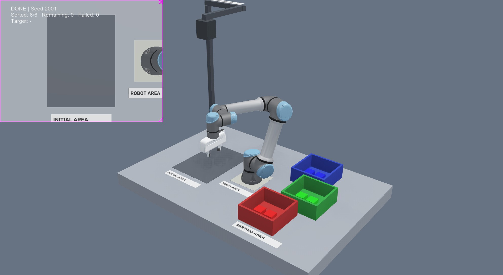
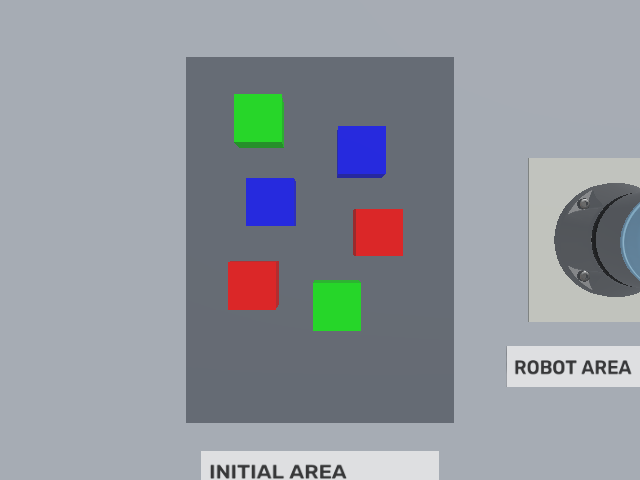

# UR5e Vision Webots Simulation

一套以 **Webots R2023b + Python + OpenCV** 製作的工業機器手臂模擬系統。UR5e 會從俯視相機影像辨識紅、綠、藍方塊，估算桌面座標，再以六軸逆運動學驅動夾爪完成抓取與顏色分類。

> 這是我拿來做大學光機電工程概論期中報告實作的專案。最後整理成這個可以搬到其他 Windows 電腦重建環境的版本。



## 專案亮點

- 俯視相機的 BGRA 影像經 OpenCV 進行紅、綠、藍輪廓辨識。
- 由像素位置反投影至桌面 XY 座標，不用 Supervisor 真值控制手臂。
- 六軸逆運動學、關節限制、路徑插值與狀態機自動串接。
- 使用 PandaHand 進行純接觸與摩擦抓取，沒有瞬移物件或吸附作弊。
- 隨機生成 3～6 顆方塊，至少包含三種顏色，完成後由獨立 Supervisor 驗證。
- UR5e、PandaHand 和必要材質均已本地化，不需在執行時下載模型。
- 同時保留第一階段「紅色方塊視覺跟隨」展示。

## 快速開始（Windows x64）

先安裝：

1. [Webots R2023b](https://github.com/cyberbotics/webots/releases/tag/R2023b)
2. Python 3.11 x64（建議安裝官方 `py` launcher）

接著：

```powershell
git clone https://github.com/HanX2017/UR5e_Vision_WebotsSimu.git
cd UR5e_Vision_WebotsSimu
```

依序雙擊：

1. `Setup_Portable.cmd`：建立專案內 `.venv` 並安裝固定版本套件。
2. `Start_Sorting.cmd`：啟動自動辨識、抓取與顏色分類。

第一次啟動若找不到 Webots，命令視窗會要求貼上 Webots 安裝資料夾或 `webots.exe` 路徑。設定只會存在本機的 `config/webots.json`。

### 其他

| 檔案 | 用途 |
| --- | --- |
| `Start_Sorting.cmd` | 第二階段完整自動分類展示 |
| `Start_Demo.cmd` | 第一階段紅色方塊視覺跟隨 |
| `Configure_Webots.cmd` | 重新指定 Webots R2023b 路徑 |
| `Run_Unit_Tests.cmd` | 執行演算法與可攜性測試 |
| `Run_Sorting_Test.cmd` | 固定 seed 1001 的 headless 完整流程測試 |

## 流程概觀

```text
隨機生成方塊
      ↓
俯視相機影像 → 顏色分割／輪廓 → 像素反投影 → 目標 XY
                                                ↓
分類完成驗證 ← 放入對應色框 ← 夾爪與六軸路徑 ← IK 求解
```

相機實際辨識畫面：



## 專案結構

```text
controllers/            Webots 視覺、手臂與 Supervisor 控制器
sorting/                通訊、視覺、場景、設定與運動學模組
worlds/                 第一、二階段 Webots 世界檔
models/                 本地化 UR5e、PandaHand 與相關材質
config/                 視覺及分類參數
tests/                  單元與可攜性測試
docs/                   架構、測試與可攜版說明
portable_launcher.py    環境隔離、Webots 尋找與啟動器
portable_support.py     控制器 Python 環境稽核
```

更完整的模組關係請看 [系統架構](docs/ARCHITECTURE.md)。

## 可攜版

這個 GitHub repo 是「**原始碼可攜版**」：clone 後由 `Setup_Portable.cmd` 在專案內建立 `.venv`，不污染全域 Python。Webots 本體仍需另外安裝。

## 調整參數

主要設定位於 `config/sorting.json`：

- `mode`：`random` 或 `fixed`
- `seed`：重現亂數配置
- `object_count`：3～6
- `show_window`：是否顯示 OpenCV 視窗

場景幾何、相機位置或方塊尺寸同時存在於世界檔與設定檔；若要改動，需要一起校正，不能只改 JSON。

## 已知限制與安全聲明

- 僅針對 Windows x64、Python 3.11、Webots R2023b 驗證。
- 未涵蓋任意旋轉、堆疊、光照變化、完整全身碰撞規劃和長時間耐久測試。
- 這是教學與報告用模擬，不是可直接部署到真實工業設備的安全控制軟體。

## 授權、致謝與第三方資源

專案自有程式碼採 [BSD 4-Clause License](LICENSE)，允許個人、教學、研究、修改、再散布與商業用途。若在報告、論文、簡報、影片、產品、網站或其他公開材料中提及功能或使用本專案，必須顯示以下致謝：

> 本作品使用 HanX2017 開發的 UR5e_Vision_WebotsSimu 專案。

英文可使用：`This work uses UR5e_Vision_WebotsSimu by HanX2017.`

可直接使用 GitHub 的「Cite this repository」或 [CITATION.cff](CITATION.cff) 產生引用；完整致謝文字見 [NOTICE](NOTICE)。UR5e、PandaHand、Webots 相關模型與 Python 套件仍保留各自原始授權，整理於 [第三方授權](THIRD_PARTY_NOTICES.md)。
